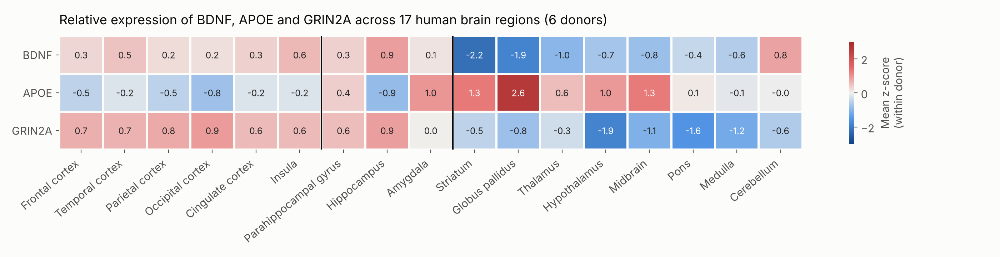
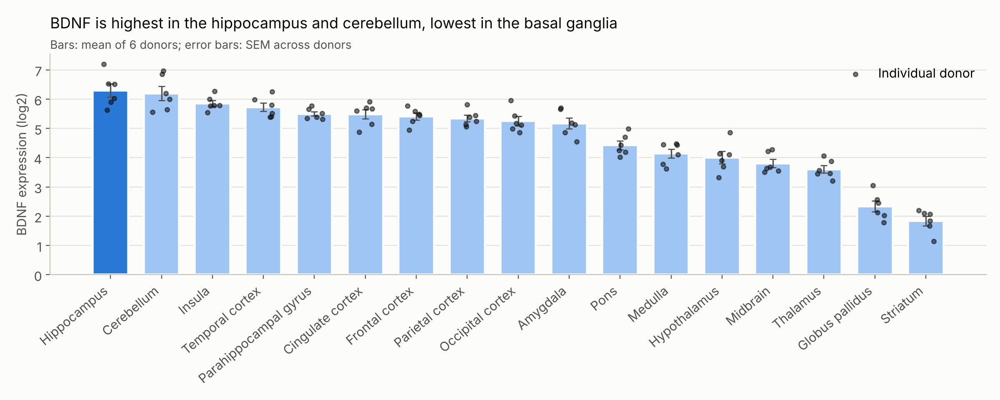

# Regional gene expression in the human brain (Allen Human Brain Atlas)



An exploratory analysis of where three memory- and disease-related genes are expressed in the adult human brain, using microarray data from the [Allen Human Brain Atlas](https://human.brain-map.org/) fetched live through the Allen SDK.

| Gene | Protein | Relevance |
|---|---|---|
| `BDNF` | Brain-derived neurotrophic factor | Synaptic plasticity and memory |
| `APOE` | Apolipoprotein E | Strongest common genetic risk factor for late-onset Alzheimer's disease (ε4 allele) |
| `GRIN2A` | NMDA receptor subunit GluN2A | Learning; linked to epilepsy and schizophrenia |

## What the notebook does

1. **Fetches data** with `allensdk`'s `RmaApi`: gene and probe IDs, the 6 donors, and probe-level log2 expression for all **3,702 tissue samples**.
2. **Checks probe quality**: probes for the same gene correlate at r = 0.65 to 0.96, so they are averaged.
3. **Maps fine structures to 17 broad regions** using the atlas ontology (white matter and ventricles excluded, 150 samples).
4. **Aggregates with pandas**: probes → gene per sample → region per donor → mean ± SEM across donors. Every region is sampled in all 6 donors.
5. **Visualises** a gene × region heatmap (within-donor z-scores) and a bar plot of BDNF by region with individual donors shown.
6. **Summarises patterns** with a paired hippocampus-vs-neocortex test and cross-gene correlations, then interprets them.

## Key findings

- **BDNF** is highest in the hippocampus and cerebellum and lowest in the striatum and globus pallidus (a ~4.5 log2-unit range). Hippocampus exceeds the neocortical average by 0.78 log2 units (paired t-test p = 0.014, n = 6 donors).
- **GRIN2A** is enriched across neocortex and hippocampus and lowest in the hypothalamus, pons and medulla.
- **APOE** runs opposite to both (Spearman ρ = −0.69 vs BDNF, −0.77 vs GRIN2A): highest in the globus pallidus, midbrain and striatum, low in the hippocampus. This likely reflects glial content, since APOE is mainly astrocytic.



See the notebook for the full interpretation and limitations (6 healthy donors, bulk microarray, no cell-type resolution).

## Setup

### Google Colab
Open `allen_brain_gene_expression.ipynb` in Colab and run all cells. The first cell installs what is missing. No account or API key is needed. The install path was tested in a clean Python 3.12 environment (Colab's current default), not inside Colab itself.

### Local
```bash
python -m venv .venv && source .venv/bin/activate
pip install -r requirements.txt
pip install --no-deps allensdk==2.16.2
jupyter notebook allen_brain_gene_expression.ipynb
```

**Why `--no-deps`?** `allensdk` 2.16.2 (the current release) pins `numpy<1.24` and `pandas==1.5.3`, which cannot be built on Python 3.12, so a plain `pip install allensdk` fails there. This project only uses the SDK's REST query client, which works with current numpy and pandas. `requirements.txt` adds just the packages its import chain needs. Tested on Python 3.12 from a clean environment; pip prints harmless version-conflict warnings.

## Repository layout

```
allen_brain_gene_expression.ipynb   analysis notebook (with outputs)
figures/                            exported PNGs
data/region_summary.csv             gene × region summary (mean, SEM, z-score)
data/expression_long.csv            raw probe-level cache, created on first run (git-ignored)
requirements.txt
```

## Data source

Allen Institute for Brain Science. *Allen Human Brain Atlas*, available from human.brain-map.org. Hawrylycz, M. J. et al. (2012). An anatomically comprehensive atlas of the adult human brain transcriptome. *Nature*, 489, 391–399. https://doi.org/10.1038/nature11405
